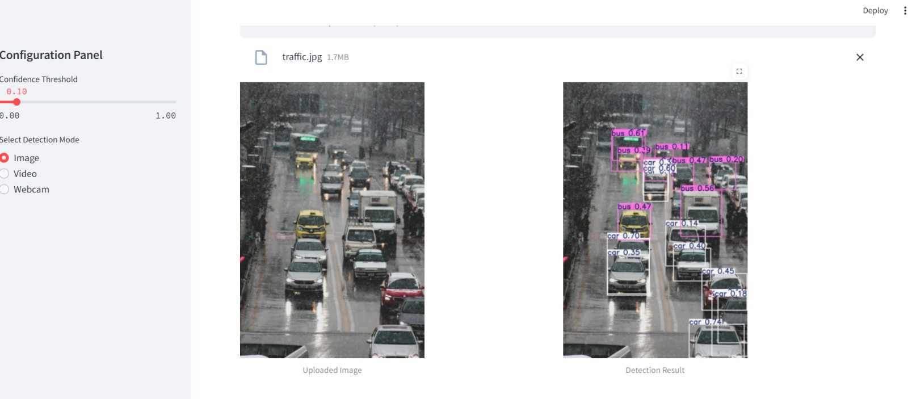
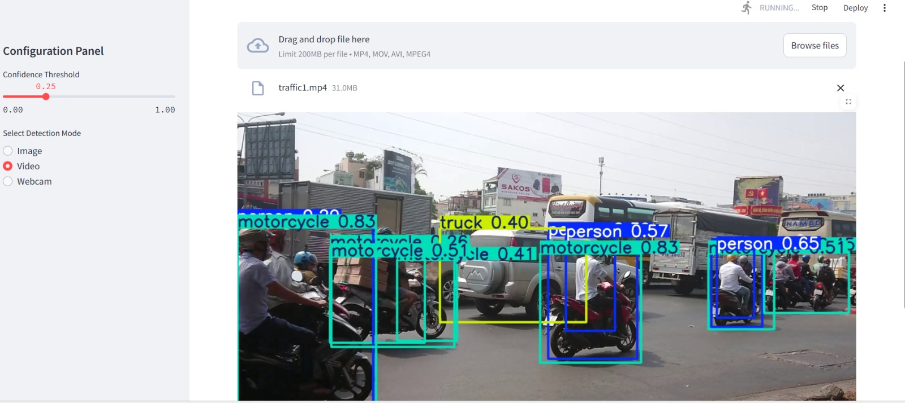

# YOLO Object Detection App

An end-to-end real-time object detection web application built with **Ultralytics YOLO (YOLO11n)** and **Streamlit**. Detect objects from images, uploaded videos, and live webcam streams with customizable confidence thresholds and side-by-side visualization.




---

## Table of Contents

- [Overview](#overview)
- [Key Features](#key-features)
- [Project Structure](#project-structure)
- [System Requirements](#system-requirements)
- [Quick Start Installation](#quick-start-installation)
  - [1. Clone Repository](#1-clone-repository)
  - [2. Create & Activate Virtual Environment](#2-create--activate-virtual-environment)
  - [3. Install Dependencies](#3-install-dependencies)
  - [4. Run Environment Diagnostics](#4-run-environment-diagnostics)
  - [5. Run Automated Tests](#5-run-automated-tests)
- [Running the App](#running-the-app)
- [Detection Modes](#detection-modes)
  - [Image Detection](#image-detection)
  - [Video Detection](#video-detection)
  - [Webcam Live Detection](#webcam-live-detection)
- [Troubleshooting & FAQ](#troubleshooting--faq)
- [Google Colab Training Notebook](#google-colab-training-notebook)
- [License](#license)

---

## Overview

The **YOLO Object Detection App** integrates Ultralytics YOLO with Streamlit to deliver high-performance visual inference in a clean, interactive dashboard. 

The application utilizes a fine-tuned YOLO11 Nano model (`trained_model.pt`) trained on the COCO2017 dataset covering 80 object categories (such as `person`, `car`, `traffic light`, `dog`, `laptop`, `cell phone`).

---

## Key Features

- **Real-Time YOLO Inference:** Fast and lightweight detection using fine-tuned YOLO11n weights.
- **Resource Caching:** Model weights are loaded once into GPU/CPU memory via Streamlit's `@st.cache_resource`, eliminating redundant reload delays across user interactions.
- **Multi-Modal Input:**
  - **Images:** Upload JPG, JPEG, or PNG files with side-by-side original and annotated comparison, object count, detailed classification breakdown table, and annotated image download button.
  - **Videos:** Frame-by-frame processing for MP4, MOV, AVI, and MKV with progress monitoring, live playback, and a stop button.
  - **Live Webcam:** Real-time WebRTC browser streaming supporting both local machines and remote/cloud server deployments.
- **Reliable Resource Management:** OpenCV captures and temporary files are automatically released and unlinked using robust `try ... finally` blocks.
- **Clear Error Diagnostics:** Actionable error reporting with exact underlying exceptions rather than swallowed tracebacks.

---

## Project Structure

```
YOLO-Object-Detection-App/
├── app.py                        # Streamlit web application
├── check_environment.py          # Environment & dependency diagnostic script
├── test_app.py                   # Automated test suite (unit & smoke tests)
├── requirements.txt              # Production dependency specifications
├── trained_model.pt              # Trained YOLO11n model weights (80 COCO classes)
├── Object_Dectection_Model.ipynb # Google Colab notebook for data prep and training
├── Screenshots/                  # Application interface screenshots
└── README.md                     # Documentation
```

---

## System Requirements

- **Python:** Python 3.9, 3.10, or 3.11 (64-bit recommended).
- **OS:** Windows 10/11, macOS, or Linux.
- **Memory:** 4 GB RAM minimum (8 GB recommended for video processing).

---

## Quick Start Installation

### 1. Clone Repository

```bash
git clone https://github.com/viveknair6915/YOLO-Object-Detection-App.git
cd YOLO-Object-Detection-App
```

### 2. Create & Activate Virtual Environment

Always use an isolated virtual environment to avoid package version conflicts:

**Windows (PowerShell):**
```powershell
python -m venv venv
.\venv\Scripts\Activate.ps1
```

**Windows (Command Prompt):**
```cmd
python -m venv venv
venv\Scripts\activate.bat
```

**macOS / Linux:**
```bash
python3 -m venv venv
source venv/bin/activate
```

### 3. Install Dependencies

Use `python -m pip` to ensure installation into the active environment:

```bash
python -m pip install --upgrade pip
python -m pip install -r requirements.txt
```

> [!TIP]
> **OpenCV Packaging Note:** `requirements.txt` specifies `opencv-python`. Never install both `opencv-python` and `opencv-python-headless` in the same environment, as conflicting namespace binaries can cause runtime import failures.

### 4. Run Environment Diagnostics

Before starting the web app, run the built-in diagnostic script to verify your setup:

```bash
python check_environment.py
```

This verifies:
- Active Python interpreter and version
- Clean imports of OpenCV, Ultralytics, PyTorch, Torchvision, NumPy, Pillow, Streamlit, and WebRTC
- Validity and file size of `trained_model.pt`
- End-to-end inference smoke tests on synthetic images and sample video frames

### 5. Run Automated Tests

Execute the automated test suite:

```bash
python -m unittest test_app.py
```
*(or run `pytest test_app.py` if pytest is installed)*

---

## Running the App

Launch the application with:

```bash
python -m streamlit run app.py
```

Once running, open your web browser to:
- **Local URL:** `http://localhost:8501`

---

## Detection Modes

### Image Detection
1. Select **Image** in the sidebar.
2. Adjust the **Confidence Threshold** slider (default: `0.25`).
3. Drag & drop or browse for an image (`.jpg`, `.jpeg`, `.png`).
4. View the original image alongside the annotated result with bounding boxes and labels.
5. Review the detection summary table or click **Download Annotated Image**.

### Video Detection
1. Select **Video** in the sidebar.
2. Upload a video file (`.mp4`, `.mov`, `.avi`, `.mkv`).
3. Real-time inference will process frames sequentially with a live progress bar.
4. Click **Stop Video Processing** at any time to halt processing safely. Temporary files are automatically cleaned up.

### Webcam Live Detection
1. Select **Webcam** in the sidebar.
2. Click **START** on the WebRTC component.
3. Allow camera permissions when prompted by your browser.
4. Frames are analyzed live and annotated bounding boxes are overlaid in real time.

---

## Troubleshooting & FAQ

### 1. `OpenCV (cv2) is not installed`
- **Cause:** OpenCV is missing from the active Python environment or a DLL is missing on Windows.
- **Fix:** Run:
  ```bash
  python -m pip install opencv-python
  ```
  On Windows N editions, install the *Windows Media Feature Pack* if OpenCV fails to load `mfplat.dll`.

### 2. `Ultralytics failed to import`
- **Cause:** `ultralytics` package not installed or incompatible PyTorch/NumPy versions.
- **Fix:** Run:
  ```bash
  python -m pip install "numpy<2" ultralytics
  ```

### 3. Model file not found
- **Cause:** `trained_model.pt` was moved, renamed, or corrupted.
- **Fix:** Ensure `trained_model.pt` is located in the root directory alongside `app.py`.

### 4. Webcam issues in Remote / Cloud Deployments
- **Note:** Streamlit executes on the server. If deploying to cloud hosting (e.g. Streamlit Community Cloud), the server does not have access to your local physical webcam (`cv2.VideoCapture(0)` cannot access your computer). The app uses **WebRTC** (`streamlit-webrtc`) so your browser streams video directly to the server. Ensure you access the app over **HTTPS** (or `localhost`) and grant camera access in your browser.

---

## Google Colab Training Notebook

The repository includes `Object_Dectection_Model.ipynb` which covers:
- **Task 1: EDA on COCO2017 Dataset** (class distribution & visualization)
- **Task 2: Preprocessing** (resizing & normalization)
- **Task 3: Data Augmentation**
- **Task 4: YOLO Format Conversion** (bounding box remapping to `<class_id> <x_center> <y_center> <w> <h>`)
- **Task 5: Model Training** (fine-tuning YOLO11n and exporting `trained_model.pt`)

---

## License

This project is licensed under the [MIT License](LICENSE).
